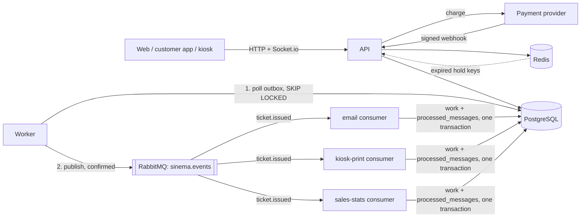

# Sinema Ticketing System – Project Overview

## Summary

A cinema ticketing system that sells tickets from the web, a customer app and a box-office kiosk at the same time, with a staff app at the doors, all backed by one API. Wherever a seat is sold, every other screen shows it as taken immediately.

What makes it stand out as a portfolio project:

- Four clients, one API: the website (Next.js), the box-office kiosk (React + Vite), and a customer app and a staff app (Expo)
- A real technical problem: never selling the same seat twice (seat locking)
- Real-time updates: seat state reaches every screen instantly
- End-to-end flow: purchase, QR ticket, QR check at the door, admin reports

## Roles and clients

There are three roles: customer, staff and admin. The web, the customer app and the kiosk sell tickets; the staff app checks them at the doors; administration lives only on the web.

| Client | Used by | What it does |
| --- | --- | --- |
| Web – customer site | Customer (guest or signed in) | Picks a movie, showtime and seats, pays, gets a QR ticket, sees their tickets; no account needed |
| Web – `/admin` panel | Admin | Adds movies, halls, seat layouts and showtimes; sees sales and occupancy reports; manages staff accounts |
| Customer app (Expo) | Customer (signed in) | Same purchase flow as the web + my tickets; an account is required |
| Staff app (Expo) | Staff | Signs in and scans QR codes at the hall entrance, which marks tickets as used |
| Kiosk (React + Vite) | Staff + customer | A two-screen box office: staff sell step by step (showtime, seats, snacks, payment) on one screen; the second screen faces the customer, lets them tap their own seats during the seats step, then shows the basket, the total and a QR code for the tickets |

## Stack

TypeScript everywhere; the backend is Node + Express with PostgreSQL, Redis and RabbitMQ.

| Part | Choice | Why |
| --- | --- | --- |
| Language | TypeScript | Types shared across all apps |
| Repo | pnpm workspaces (monorepo) | One repo, a shared `shared` package |
| Backend | Node + Express | Familiar structure |
| Database | PostgreSQL + Prisma | Relational data; transactions and unique constraints keep seats safe |
| Holds, cache, rate limits | Redis | Seat holds expire by themselves; shared state for every API instance |
| Messaging | RabbitMQ (outbox pattern) | Work after a sale (email, box-office printing, stats) runs in a worker, not in the request |
| Real-time | Socket.io + Redis adapter | Seat state on every screen instantly, from any API instance |
| Validation | Zod | Same schemas in the API and the forms |
| Auth | JWT | Same approach for web, mobile and kiosk |
| Web | Next.js (App Router) | Customer site + admin panel |
| Mobile | Expo + Expo Router | File-based routing, similar to Next.js |
| Kiosk | React + Vite | A single-page app with no SEO needs; its two windows (`/` and `/display`) are linked by a BroadcastChannel. The website stays on Next.js for SEO |
| Data fetching | TanStack Query | Same in all three clients |
| Hosting | Docker Compose | PostgreSQL, Redis, RabbitMQ, the API and the worker on our own server |

## Monorepo layout

Five apps and two shared packages live in one repo.

```
sinema/
├── apps/
│   ├── api/        Express + Prisma + Socket.io; src/worker.ts is the outbox relay and the RabbitMQ consumers
│   ├── web/        Next.js (customer site + /admin)
│   ├── kiosk/      React + Vite box office (staff screen + customer screen)
│   ├── mobile/     Expo customer app
│   └── staff/      Expo staff app (QR scanning at the doors)
├── packages/
│   ├── shared/     shared types, Zod schemas, constants, translations
│   └── client/     code shared by the Expo apps and the kiosk: API client, session store, live seat updates
├── docker-compose.yml
├── package.json
└── pnpm-workspace.yaml
```

Note: from Expo SDK 52, Metro is configured for monorepos automatically, and pnpm's isolated installs work from SDK 54.

## Architecture

The API and a separate worker process share three stores, each holding what it is best at.



| Store | Holds | Why there |
| --- | --- | --- |
| PostgreSQL | Everything that must not be lost: users, the schedule, orders, tickets, vouchers, and the bookkeeping that makes retries safe (`idempotency_keys`, `processed_webhooks`, `processed_messages`, `outbox`), plus `print_jobs` and `daily_sales` written by the workers | Transactions, constraints and the partial unique index on tickets are the final word on who owns a seat |
| Redis | Seat holds (`hold:<showtime>:<seat>`, SET NX with a 10-minute expiry, plus a sorted set per showtime and a set per holder), cached showtime lists and seat maps (tag versions for invalidation), rate-limit counters, the Socket.io adapter's pub/sub | Short-lived, fast, shared by every API instance; losing it only frees holds and empties caches |
| RabbitMQ | `ticket.issued` events on the `sinema.events` topic exchange; one queue per consumer, each with a `.retry` queue (5 s delay, dead-letters back) and a `.dlq` | Work after a sale happens outside the request, can fail and retry on its own, and each consumer goes at its own pace |

### Idempotency, layer by layer

A request, a webhook or a message can arrive twice; each layer turns the repeat into a no-op.

1. **Clients → API.** Checkout requests carry an `Idempotency-Key` header. The first request inserts `(caller, key)` into `idempotency_keys` and stores the response when done; a repeat gets the stored response (`Idempotent-Replayed: true`), a repeat while the first still runs gets 409, and the same key with a different body gets 422.
2. **Provider → API.** Each webhook event id is inserted into `processed_webhooks` with `ON CONFLICT DO NOTHING` in the same transaction as the order update; a redelivery finds the row and stops.
3. **Order state.** Orders only move `PENDING → PAID` or `PENDING → FAILED` with `UPDATE ... WHERE status = 'PENDING'`; zero rows means it was already settled. Tickets move `PAID → USED` and vouchers `PAID → USED` the same way.
4. **Seats.** Redis holds stop most conflicts early, but the partial unique index on `Ticket(showtimeId, seatId) WHERE status <> 'CANCELLED'` is what guarantees one seat, one ticket: if two paid orders race for a seat, one insert fails, that order is marked FAILED and refunded.
5. **RabbitMQ → consumers.** The message id is the outbox row id. Each consumer inserts `(consumer, message id)` into `processed_messages` in the same transaction as its work and acks only after the commit; a redelivery finds the row and is acked without doing anything.

### Outbox flow

1. The webhook (or a cash sale) settles the order in one transaction: tickets, vouchers and an `outbox` row `ticket.issued {orderId}`. If the transaction rolls back, there is no event; if it commits, the event cannot be lost.
2. The worker's relay polls `SELECT ... FROM outbox WHERE published_at IS NULL ORDER BY created_at LIMIT 50 FOR UPDATE SKIP LOCKED` (a partial index keeps this to the backlog), publishes on a confirm channel with `messageId` = row id, waits for the broker's confirms and marks the rows `published_at`. A failure leaves them for the next pass; several relays never send the same row at once.
3. Each consumer queue gets a copy. A failing message is copied to `<queue>.retry` with `x-attempts` raised and comes back after the delay; after 5 attempts it is parked in `<queue>.dlq`.
4. Delivery is at least once end to end, made exactly once in effect by step 5 of the idempotency layers. Email is the one side effect outside the database, so in the rare case a send succeeds and the commit then fails, the email goes out twice.

The QR code images are not stored: they are drawn from the signed token whenever asked for.

## Data model

Eleven domain tables (user, movie, hall layout, hall, seat, showtime, order, ticket, product, order item, concession voucher) and six for reliability and the workers (idempotency keys, processed webhooks, processed messages, outbox, print jobs, daily sales). Seat holds live in Redis, not in a table.

| Table | Main fields | Notes |
| --- | --- | --- |
| User | id, email, passwordHash, name, role (CUSTOMER / STAFF / ADMIN) | Guest purchases have no user |
| Movie | id, title, description, durationMin, genre, posterUrl, tmdbId? | Fixed catalog from the seed |
| HallLayout | id, name, rows (JSON: row label + cells) | Seating plans: S standard, V VIP, W wheelchair, _ aisle |
| Hall | id, name, layoutId?, formats (TWO_D / THREE_D / IMAX / IMAX_3D) | A showtime's format must be one the hall supports |
| Seat | id, hallId, row (A, B…), number, column, type (STANDARD / VIP / WHEELCHAIR) | Built from the hall layout; column keeps aisles. Unique: hallId + row + number |
| Showtime | id, movieId, hallId, startsAt, price, format | price is the list price; discounts are applied automatically. No overlapping showtimes in the same hall |
| Order | id, holderId, userId?, amount, status (PENDING / PAID / FAILED), provider, paymentMethod, providerRef?, showtimeId, seatIds, seatPrice, channel, locale, contactEmail?, accessToken, createdAt | Groups the tickets bought in one payment; a PENDING order carries the seats and price to issue when the webhook confirms it. accessToken is unique |
| Ticket | id, orderId, showtimeId, seatId, userId?, status (PAID / USED / CANCELLED), qrToken, channel (WEB / MOBILE / KIOSK), createdAt | Unique: showtimeId + seatId (among non-cancelled tickets) |
| Product | id, name (JSON by language), description?, category (COMBO / SNACK / DRINK / GLASSES), price, sortOrder, active | The concession stand; 3D glasses are sold only for 3D and IMAX 3D showtimes |
| OrderItem | id, orderId, productId, quantity, unitPrice | Price at the time of sale |
| ConcessionVoucher | id, orderItemId, qrToken, status (PAID / USED / CANCELLED), usedAt? | One per unit, each with its own QR code, so items can be collected separately or shared |

Money is stored as integer cents.

## Purchase flow and seat locking

A selected seat is held for 10 minutes in Redis; if payment does not finish in that time, the hold expires and the seat frees itself.

1. The customer picks a movie and a showtime (grouped by day, then by format).
2. The API returns the showtime's seats: the cached hall and sold seats, with the live holds from Redis laid over them.
3. The customer picks seats; one Lua script in Redis holds all of them or none (`SET NX PX`), releases the holder's seats in any other showtime and enforces the limit.
4. Socket.io broadcasts "seat locked" to every client through the Redis adapter.
5. Optional second step: snacks, drinks and combos; for 3D and IMAX 3D, 3D glasses come first with a "one per seat" shortcut. Third step: the basket (tickets, items, total) and payment. On the web the customer enters an email, as a guest if they like.
6. Checkout (with an `Idempotency-Key` header) confirms and extends the holds, creates a PENDING order with the seats and prices fixed, and asks the provider to charge; it answers 202. Cash at the box office settles at once (201).
7. The provider's signed webhook settles the order in one transaction: the event id is recorded, the order moves to PAID, tickets and vouchers are written with their QR tokens, and the `ticket.issued` event goes to the outbox. The holds are then released, caches invalidated and "seat sold" broadcast. A declined payment moves the order to FAILED and keeps the holds, so the customer can try again. Clients follow the order with `GET /checkout/orders/:id` until it is PAID or FAILED.
8. The worker relays the event to RabbitMQ; the email consumer sends the QR codes and a link to `/orders/<accessToken>`, the kiosk-print consumer queues box-office tickets for the printer, and the sales-stats consumer adds the sale to `daily_sales`. A failed email does not undo the sale.
9. If there is no payment within 10 minutes, the hold key expires; Redis reports it and the seat is broadcast as free.
10. At the entrance, staff scan the QR code; a `PAID` ticket becomes `USED`, anything else is rejected.

Rules:

- Hold duration: 10 minutes, extended to at least 3 minutes once payment starts
- A holder buys for one showtime at a time: locking seats in another showtime releases the rest at once
- A user or kiosk session can hold at most 10 seats at once
- QR tokens must be unguessable (random, signed)
- A QR code holds a link to its own page: `<WEB_URL>/t/<qrToken>` for tickets, `<WEB_URL>/c/<qrToken>` for concession items. Any phone camera opens it; scanners take the kind and the code out of the link
- The door only admits tickets and the stand only hands over items; each turns the other kind away without using it up, so the two never block each other
- The box office holds seats under the signed-in staff member; clearing a sale releases them, otherwise they expire like any other hold
- Box-office sales are paid in cash or by card at the counter; the email is optional and the tickets belong to no account
- The box office locks after 2 minutes without input, or from the header; the staff member's six-digit lock PIN unlocks it and the sale underneath is kept. The PIN is set once on the account (and changed from the header); at sign-in the API sends its salted digest so unlocking needs no round trip. After 3 wrong PINs the account password is asked instead, followed by an offer to set a new PIN. While locked, or with nobody signed in, the customer screen shows the counter as closed

## API and Socket.io events

REST endpoints live under `/api`; real-time events go to per-showtime rooms.

| Method | Path | What it does | Access |
| --- | --- | --- | --- |
| POST | /auth/register, /auth/login | Sign up and sign in, returns a JWT | Anyone |
| POST | /auth/guest | Start a guest session for a channel (WEB / MOBILE / KIOSK), returns a guest JWT | Anyone |
| GET | /movies | Movies now showing | Anyone |
| GET | /movies/:id | One movie | Anyone |
| GET | /movies/:id/showtimes | A movie's upcoming showtimes | Anyone |
| GET | /showtimes?from=&to= | Every movie's showtimes in a window of up to 8 days, with the seats left, for the box office | Anyone |
| GET | /showtimes/:id/seats | Seats + state (free / locked / sold) | Anyone |
| POST | /showtimes/:id/locks | Hold seats (Redis, 10 minutes; 60 a minute) | Customer, guest, staff |
| DELETE | /locks/:id | Release a hold (`<showtimeId>:<seatId>`) | Hold holder |
| POST | /checkout | Start a card payment: PENDING order, 202 (Idempotency-Key header; 10 a minute) | Customer, guest |
| GET | /checkout/orders/:id | Follow one's own order until PAID or FAILED | Order holder |
| POST | /webhooks/payments/:provider | Signed payment outcome from the provider; settles the order | Provider |
| PUT | /me/pin | Set or change the caller's six-digit box-office lock PIN | Staff, admin |
| POST | /checkout/kiosk | Box-office sale: cash settles at once (201), card like online (202); optional email, channel KIOSK | Staff, admin |
| GET | /me/tickets | Tickets bought by this user or guest session | Customer, guest |
| GET | /orders/:accessToken | An order's tickets, for the emailed link | Link holder |
| GET | /tickets/:qrToken | One ticket, for the link in its QR code | Code holder |
| GET | /products?showtimeId= | Products on sale; glasses only for 3D showtimes | Anyone |
| GET | /me/concessions | Concession items bought by this user or guest | Customer, guest |
| GET | /concessions/:qrToken | One item, for the link in its QR code | Code holder |
| GET | /concessions/:qrToken/qr.png | An item's QR code as an image, for emails | Code holder |
| POST | /concessions/collect | Hand an item over at the stand | Staff |
| GET | /tickets/:qrToken/qr.png | A ticket's QR code as an image, for emails | Code holder |
| POST | /tickets/verify | Check a QR code, mark the ticket used | Staff |
| GET, POST | /admin/layouts | List layouts (with seats and halls using them), create one | Admin |
| GET, PUT, DELETE | /admin/layouts/:id | One layout; save it; delete it unless halls use it | Admin |
| GET, POST | /admin/halls | List halls (seats, upcoming showtimes, sales), create one, optionally from a layout | Admin |
| PATCH | /admin/halls/:id | Rename, change formats (not ones upcoming showtimes use) | Admin |
| PUT | /admin/halls/:id/layout | Rebuild a hall's seats from a layout; refused once it has sales | Admin |
| CRUD | /admin/movies, /admin/showtimes | Administration (next) | Admin |
| GET | /admin/reports/sales | Sales and occupancy report | Admin |

Socket.io:

- A client joins a showtime room with `showtime:join`
- The server broadcasts `seat:locked`, `seat:released` and `seat:sold` to that room

## Decisions

These are the defaults; changes are recorded here.

| Topic | Decision |
| --- | --- |
| Project | Cinema ticketing system (web + mobile + kiosk) |
| Database | PostgreSQL + Prisma (instead of MongoDB) |
| Repo | pnpm monorepo, no Turborepo for now |
| Seat hold | 10 minutes, in Redis |
| Payment | Simulated first (`FakeProvider`) behind a `PaymentProvider` interface; a real provider's test mode (iyzico or Stripe) after the MVP |
| Real-time | Yes, Socket.io with the Redis adapter |
| Messaging | RabbitMQ through a transactional outbox; idempotent consumers, retry queue, DLQ |
| Kiosk ticket | QR on screen first, printer later |
| Ticket delivery | Email only, sent by the email worker through EmailJS's REST API (private key stays on the server); logged instead of sent when EmailJS is not configured |
| Accounts | Web: optional, guests buy with an email. Customer app: required. Staff app: staff and admin accounts only. Kiosk: staff sign in; customers need no account |
| Schedule | The seed plans each hall's day back to back for 7 days; a full schedule through 2030 comes later |
| Content language | Code and docs in English; the UI is English and Turkish, picked from the system language |
| Formats | 2D, 3D, IMAX and IMAX 3D; each hall lists the formats it supports and the same movie can run in several formats on one day |
| Discounts | Automatic flags from the start time, in cinema time: Wednesday is people's day (50% off); other weekdays before 17:00 get 15% off; at most one applies |
| Concessions | Products with their own QR codes per unit, collected at the stand; staff pick Door or Stand mode in the staff app |
| Hall layouts | Reusable seating plans (rows of S/W/_ cells) that halls are built from; the admin panel will create and assign them |
| Movie data | Now-playing movies from TMDB (titles, runtimes, genres, poster links) in `apps/api/prisma/movies.json`; descriptions are written by us; TMDB is credited in the apps |

## Roadmap

Every phase ends with something that runs and can be demoed.

1. **Foundation** – monorepo skeleton, PostgreSQL in Docker, Prisma schema, seed data
2. **API** – auth, movie/showtime endpoints, seat locking + checkout, QR verification, tests
3. **Web** – movie list → showtime → seat picker → payment → my tickets
4. **Mobile** – customer app (purchase flow) and staff app (QR scanning)
5. **Kiosk** – two-screen box office: staff screen to sell, customer-facing screen with seats, total and QR codes
6. **Admin** – movies, hall layouts and halls, showtimes, products, and the sales report; the seed covers demos until then
7. **Release (MVP)** – API + web live, demo accounts, README
8. **Polish** – screen recording, architecture diagram, a "how I solved double booking" write-up
